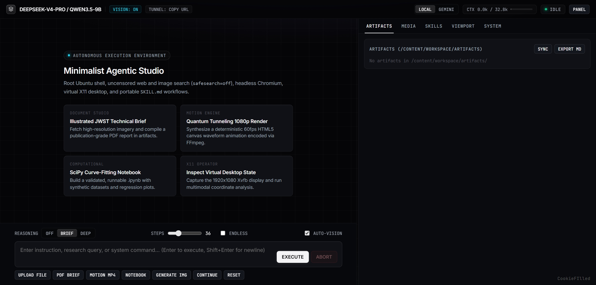
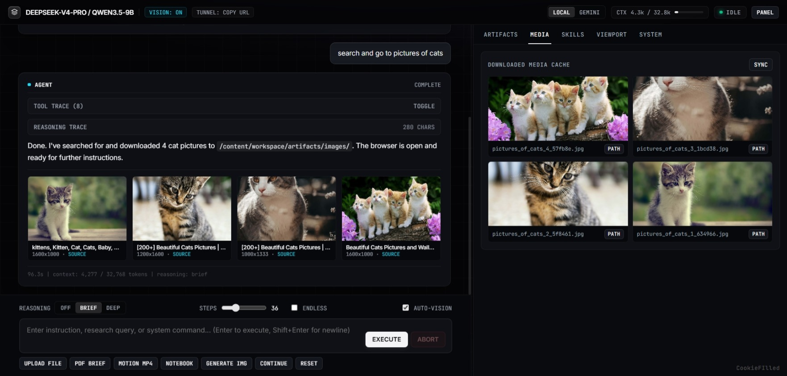
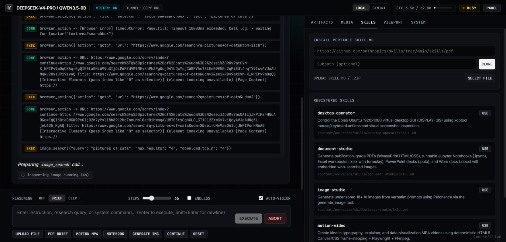
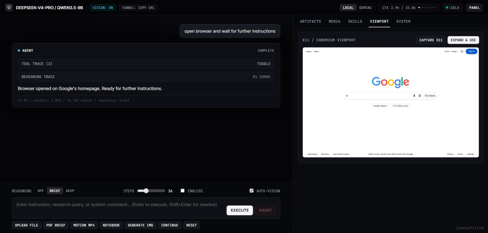
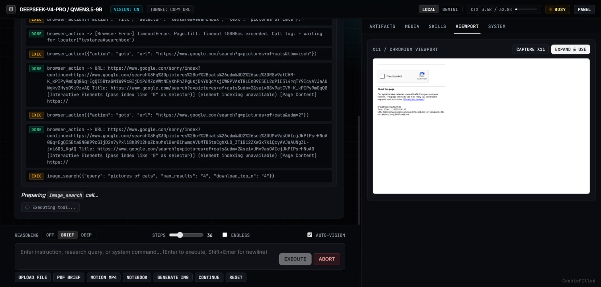
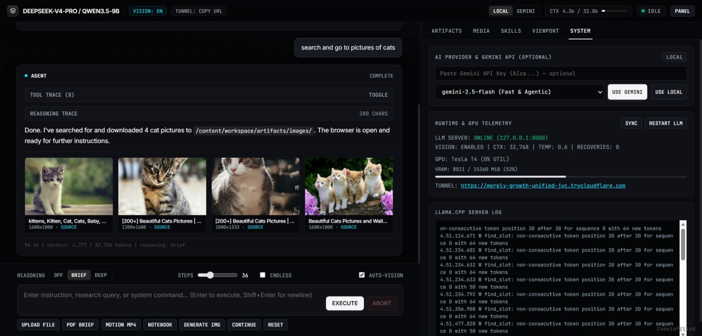

# Autonomous Agentic Workspace (`DeepSeek-V4-Pro · Qwen3.5-9B`)

A self-contained autonomous AI engineering, research, and desktop automation studio built for **Google Colab GPUs (T4 / L4 / A100)**. Powered by a native CUDA `llama-server` backend running **DeepSeek-V4-Pro · Qwen3.5-9B** with paired multimodal vision (`mmproj`), uncensored web and image search, headless Playwright Chromium, a live `1920x1080` X11/noVNC virtual desktop, and a dark-mode FastAPI + SSE studio UI exposed over Cloudflare Tunnel.

  

---

## Core Capabilities

- **Native CUDA Inference + Auto-Healing Watchdog:** Runs prebuilt `sm_75`+ CUDA `llama-server` (with automatic `llama-cpp-python` CUDA wheel fallback), `--flash-attn on`, `q8_0` K/V cache quantization, up to `49,152`-token context with rolling turn compaction, and background crash recovery.
- **Hybrid Local / Cloud Provider Switcher:** Toggle instantly in the topbar between your local Colab GPU GGUF model and the **Gemini API** (`gemini-2.5-flash`, `gemini-2.5-pro`, `gemini-2.0-flash`) without losing conversation state.
- **Multimodal Vision & Coordinate Grid Grounding:** Pairs a GGUF `mmproj` vision projector with automatic cyan coordinate-grid overlays (`x200..x1800`, `y200..y1000`) so the agent can inspect screenshots, verify downloaded images, and click exact pixel targets on the X11 desktop.
- **Uncensored Web, Image & Media Engine:** Multi-engine web search (`safesearch=off`, `region=wt-wt`) with DuckDuckGo HTML and Brave fallbacks, fast HTTP-to-Markdown page extraction, anti-hotlink image downloader, and verbatim AI image generation.
- **Headless Chromium & Live `1920x1080` X11 Virtual Desktop:** Automates indexed DOM elements (`[0]`, `[1]`, ...) in Playwright Chromium alongside an interactive `Xvfb` + `Fluxbox` + `x11vnc` + `noVNC` desktop overlay directly inside the web UI.
- **Deterministic Motion Graphics & Office Artifacts:** Renders frame-accurate `60fps` HTML5 Canvas/CSS animations (`window.seekToFrame`) into H.264 `.mp4` videos via FFmpeg, plus publication-grade `.pdf` (WeasyPrint), `.ipynb`, `.xlsx`, `.pptx`, and `.docx` files.
- **Portable `SKILL.md` Workflow Loader:** Supports progressive-disclosure `SKILL.md` packages—installable via GitHub repository URL/subpath or `.md`/`.zip` upload.

---

## Interface & Workspace Showcase

| Studio View | Preview |
| :--- | :--- |
| **1. Autonomous Tool Execution & Media Cache** Live tool traces, inline verified image cards, and one-click path copying inside the **MEDIA** inspector tab. |  |
| **2. Portable `SKILL.md` Registry** Clone skills directly from GitHub repositories or upload `.zip`/`.md` bundles with progressive disclosure. |  |
| **3. Live X11 / Chromium Viewport & noVNC** Inspect the `1920x1080` virtual display or click **EXPAND & USE** for full interactive VNC control in-browser. |  |
| **4. Multi-Step Browser Automation** Automatic fallback handling, DOM indexing, and real-time step/reasoning budget controls (`OFF` / `BRIEF` / `DEEP`). |  |
| **5. GPU Telemetry & Hybrid API Controls** Monitor Tesla T4 VRAM utilization, `llama-server` logs, Cloudflare Tunnel URLs, and switch between Local GPU and Gemini API. |  |

---

## Architecture & Built-in Toolset

### System Stack

| Layer | Implementation |
| :--- | :--- |
| **Default Model** | `mradermacher/DeepSeek-V4-Pro-Qwen3.5-9B-UNCENSORED-heretic-GGUF` (`Q4_K_M` default; supports `Q5_K_M`, `Q6_K`, `Q8_0`) |
| **Inference Engine** | Native CUDA `llama-server` (`127.0.0.1:8000/v1`, OpenAI-compatible) with `llama-cpp-python[server]` fallback |
| **Web Studio & Proxy** | FastAPI + Uvicorn (`127.0.0.1:7860`), Server-Sent Events (SSE) streaming, WebSocket-to-TCP `websockify` VNC bridge |
| **Public Access** | Automatic `cloudflared` quick tunnel (`https://*.trycloudflare.com`) + embedded Google Colab iframe |
| **Virtual Display** | `Xvfb :99` (`1920x1080x24`), `fluxbox`, `xdotool`, `scrot`, `x11vnc`, and `/usr/share/novnc` |

### Agent Tools (`11` Native Tools)

- `web_search` — Uncensored multi-backend web search (`safesearch=off`) across DDGS, DuckDuckGo HTML, and Brave.
- `fetch_url` — Clean HTTP-to-Markdown article and documentation reader (`BeautifulSoup` + `markdownify`).
- `image_search` — Uncensored multi-engine image search with automatic local download and verification to `/content/workspace/artifacts/images/`.
- `generate_image` — Uncensored 18+ AI image generation via Perchance (with Pollinations Flux fallback).
- `view_image` — Multimodal vision inspection with automatic pixel coordinate grid overlay on desktop captures.
- `browser_action` — Playwright Chromium automation (`goto`, `get_markdown`, `click`, `fill`, `scroll`, `eval_js`, `screenshot`, `render_video`).
- `desktop_action` — Direct `1920x1080` X11 GUI mouse and keyboard control (`screenshot`, `click`, `double_click`, `right_click`, `scroll`, `type`, `key`).
- `run_bash` — Non-interactive root Ubuntu shell execution inside `/content/workspace` (`DISPLAY=:99`).
- `file_ops` — Read, write, append, surgical edit, and recursive directory listing.
- `activate_skill` / `install_skill` — Load or clone portable `SKILL.md` workflows on demand.

### Included Starter Skills

| Skill | Purpose |
| :--- | :--- |
| `document-studio` | Builds styled PDFs (WeasyPrint), runnable `.ipynb` notebooks, `.xlsx` workbooks with formulas, `.pptx` decks, and `.docx` reports with embedded images. |
| `motion-video` | Synthesizes deterministic frame-by-frame HTML5 Canvas/CSS animations and encodes `1080p` H.264 `.mp4` videos with FFmpeg. |
| `web-researcher` | Coordinates multi-source web research, clean markdown extraction, and verified visual asset collection. |
| `desktop-operator` | Launches headed Chromium and operates GUI applications across the `1920x1080` X11 desktop. |
| `image-studio` | Generates verbatim high-detail AI imagery directly into the workspace media gallery. |

---

## Quick Start

1. Click the **Open in Colab** badge at the top of this README.
2. In Google Colab, select **Runtime → Change runtime type → T4 GPU** (or L4 / A100).
3. Run **Cells 1 → 5** sequentially:
   - **Cell 1 (`Environment Setup & Inference Backend`):** Verifies NVIDIA GPU, optionally mounts Google Drive (`MOUNT_GOOGLE_DRIVE`), installs CUDA `llama-server`, Playwright Chromium, FFmpeg, WeasyPrint, `cloudflared`, and starts the `1920x1080` X11 + VNC stack.
   - **Cell 2 (`Model Download & LLM Server`):** Downloads the GGUF weights and `mmproj` vision projector from Hugging Face and boots the local server with a background auto-recovery watchdog.
   - **Cell 3 (`Portable SKILL.md Manager`):** Initializes `/content/workspace/skills` and registers the 5 built-in workflows.
   - **Cell 4 (`Agent Tools & Execution Loop`):** Loads the 11 agent tools, XML tool-call parser, context compactor, and streaming execution loop.
   - **Cell 5 (`Studio Web UI & Tunnel Host`):** Starts the FastAPI studio on port `7860`, prints your public `*.trycloudflare.com` URL, embeds the UI in Colab, and runs the live health monitor.

---

## Author

Built by **[CookieFilled](https://github.com/CookieFilled)**.
